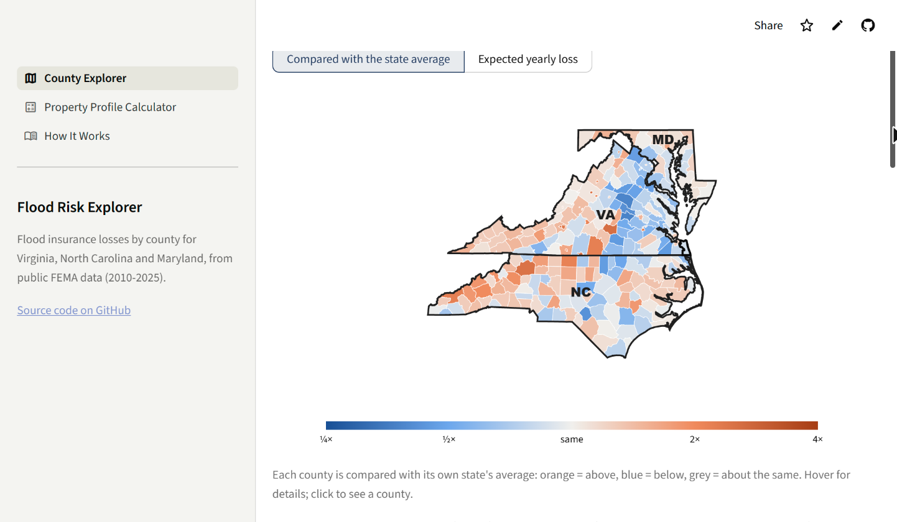
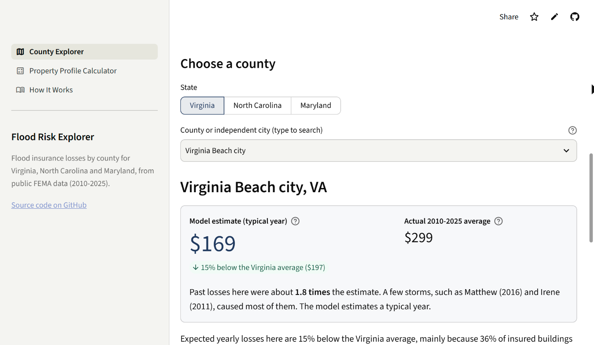
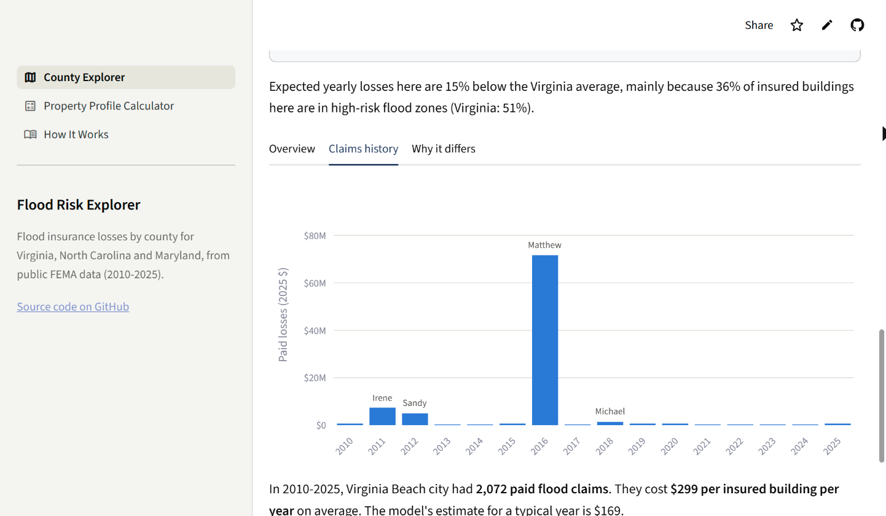
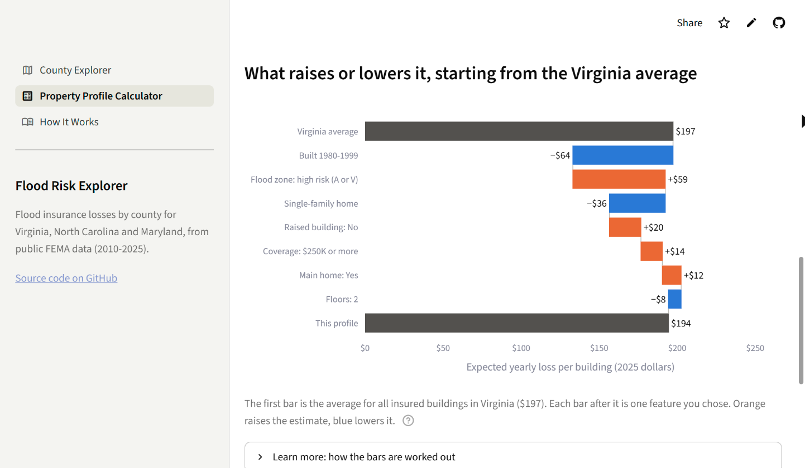

# Flood Risk Explorer

**An actuarial model of flood insurance losses for Virginia, North Carolina and Maryland, built on public FEMA data and served as a web app.**

**Live app: [flood-risk-explorer.streamlit.app](https://flood-risk-explorer.streamlit.app)** · Case study: [`reports/11_project_writeup.md`](reports/11_project_writeup.md) · Detailed findings: [`docs/findings.md`](docs/findings.md)

Using FEMA's public data on 2.7 million National Flood Insurance Program (NFIP) claims and 4.6 million policy terms, I built classic actuarial models of how often flood claims happen (frequency) and how big they are (severity) for 257 counties in three states. I tested every model on years it had never seen, compared it with XGBoost, and kept the explainable GLM because it held up better in hurricane years. The result is a web app that shows each county's expected yearly flood loss per insured building and the reasons behind it.

> **Disclaimer:** All results are **area-level** estimates built from aggregated public data. They are not predictions, quotes, or risk ratings for any individual property.

| | |
|---|---|
|  |  |
| **County map:** every county compared with its own state's average (orange = above, blue = below). | **County Explorer:** Virginia Beach's model estimate for a typical year ($169) next to its actual 2010–2025 average ($299), with the storms behind the gap. |
|  |  |
| **Claims history:** Virginia Beach's paid losses by year. Hurricane Matthew (2016) dwarfs every other year. | **Calculator:** a waterfall chart from the Virginia average ($197) to one building type, showing what raises or lowers it. |

## What I built
- **A data pipeline** that downloads NFIP claims and policies from the OpenFEMA API and turns policy records into earned exposure (policy-years) and a clean modelling table, with automated data checks.
- **Actuarial GLMs:** a Poisson GLM for claim frequency and a Gamma GLM for claim severity, multiplied into a pure premium (expected loss per policy-year), plus Bühlmann–Straub credibility and a state factor.
- **An XGBoost challenger** tuned without data leakage and compared head to head with the GLM on identical folds, under a decision rule written down before the results.
- **Explanations** of what drives risk: relativity tables, SHAP values, and exact waterfall charts for every county and building type.
- **A Streamlit web app** with a clickable county map, address lookup (Census Geocoder + FEMA flood maps), county pages and a building-type calculator, backed by automated tests.

## Key results
- **Scale:** 2.7M claim records and 4.6M policy terms, modelled for **3 states and 257 counties** (4.1M policy-years and 51,894 paid claims in 2010–2025).
- **The production GLM beats a no-information baseline by 11–13% deviance** on years it never saw (leave-one-year-out, 16 years, in each state).
- **XGBoost was about 4 points more accurate**, but it **failed the pre-stated checks** on catastrophe years and segment balance, so a **hybrid GLM** (with interactions XGBoost found) is in production.
- **Flood losses are catastrophe-driven:** 3 storm years caused **69%** of Virginia's 2009–2025 flood losses.
- **North Carolina is a different kind of flood state:** a loss cost of **$988** per policy-year vs about **$198** in Virginia and Maryland (2025 dollars).

## Tech used
Python, pandas, statsmodels, scikit-learn, XGBoost, SHAP, Plotly, Streamlit; data and lookups from the OpenFEMA API, the U.S. Census Geocoder and FEMA's National Flood Hazard Layer (flood map) API.

## About this project
I built this project with [Claude Code](https://claude.com/claude-code) as a coding assistant. It wrote much of the code and documentation under my direction. I made the modelling decisions: which questions to ask, which data and validation design to use, the rules for keeping or dropping features and models, and what the app should show. I checked the results and can explain every step.

## Try the app
**Live app:** [https://flood-risk-explorer.streamlit.app](https://flood-risk-explorer.streamlit.app) (or run it locally, see [How to run](#how-to-run-windows-powershell)).

**Features**
- **County map (first screen):** every county in Virginia, North Carolina and Maryland, shaded by expected yearly loss per insured building or by how it compares with its state average. Hover for details; click a county to open it.
- **Find my county:** type a street address to jump to its county (U.S. Census Geocoder).
- **County Explorer:** the model's estimate for a typical year next to the actual 2010–2025 average (with the storms behind any big gap), how much local claims data backs it up, the mix of insured buildings, the county's own claims history with major storms labelled, and why it differs from the state. Also at `/county`.
- **Property Profile Calculator:** describe a kind of building (or look up an address to fill in the state, county, flood zone from FEMA's flood map, and pre/post-FIRM from the area's first flood map date). See the expected yearly loss vs the state average and vs a typical lower-risk building, a chart of what raises or lowers it, and a **"What if?"** estimate of raising the building.
- **How It Works:** a three-line summary, data sources, methods with every term defined, key findings, how the certainty signals work, limitations and future work.
- Plain language on the main pages (technical detail in "Learn more" sections), a short disclaimer at the top of every page and the full one in the footer.

The app reads only the small files in `app/data/` (about 1.7 MB) and needs only streamlit, pandas, numpy, pyarrow, plotly and requests (`app/requirements.txt`). The address lookup uses only free public services with no sign-up. Details: [`app/README.md`](app/README.md).

## Reports
[`reports/11_project_writeup.md`](reports/11_project_writeup.md) (case study) · [`docs/findings.md`](docs/findings.md) (all findings) · [`01_data_overview`](reports/01_data_overview.md) · [`02_actuarial_basics`](reports/02_actuarial_basics.md) · [`03_one_way_findings`](reports/03_one_way_findings.md) · [`04_frequency_glm`](reports/04_frequency_glm.md) · [`05_severity_glm`](reports/05_severity_glm.md) · [`06_pure_premium`](reports/06_pure_premium.md) · [`07_xgboost`](reports/07_xgboost.md) · [`08_model_comparison`](reports/08_model_comparison.md) · [`09_explainability`](reports/09_explainability.md) · [`10_multistate`](reports/10_multistate.md)

## Project structure
```
src/download_data.py        download FEMA data (+ Census county names) into data/raw/
src/actuarial.py            earned exposure, frequency, severity, pure premium
src/build_dataset.py        modelling table: rating cells, 2025 dollars, data checks
src/one_way.py              one-way tables: relativities, confidence intervals, credibility, confounding checks
src/validation.py           year-based train/test splits (leave-one-year-out, time holdout)
src/models/frequency_glm.py claim-frequency GLM: fitting, forward selection, over-dispersion, LOYO scoring
src/models/severity_glm.py  claim-severity Gamma GLM: claim table, capping/loads, lognormal check, LOYO scoring
src/models/pure_premium.py  pure premium: freq x sev, off-balance, county credibility, Tweedie, lift/double lift/Gini, loss ratios
src/models/xgb_models.py    XGBoost challengers: encoding, base_margin offset, leakage-free tuning, monotone constraints
src/models/compare.py       GLM vs XGBoost on identical folds: bootstrap CIs, stability, hybrid interaction tests
src/models/production.py    loads the production model (models/production_model.json): predict + rating worksheet
src/explain.py              local explanations for the app: explain_profile, explain_county, sentences, waterfalls; builds app/data
src/global_explain.py       SHAP values: exact for the GLM, TreeSHAP for XGBoost (grouped to features)
src/multistate.py           Milestone 13: transfer test, 3-state refit + validation, consistency by state, XGBoost check, production save
src/nc_region_test.py       Milestone 16: North Carolina regional-level test (failed its pre-stated rule; not used)
src/build_county_geojson.py, src/build_firm_dates.py   one-off builders for the app's map outlines and first-flood-map dates
tests/test_explain.py       runs every county + random profiles from committed files only
tests/test_app.py           app tests (AppTest): every county, profiles, edge cases, map, address lookup (mocked), what if, no raw/processed reads
tests/test_lookup.py        address lookup tests with fake web answers (no internet)
notebooks/01-11             exploration, actuarial basics, one-way analysis, GLMs, pure premium, XGBoost, comparison, explainability, three states
models/                     saved models (production_model.json = what the app loads; XGBoost .ubj files rebuilt with xgb_models.py fit-final)
reports/                    written findings + figures
docs/                       detailed findings, data dictionary, modelling dataset, production model, project plan, validation plan
app/app.py, app/views/      Streamlit app (see app/README.md)
app/data/                   small precomputed files the app reads (county summary, rating tables, history; committed)
```
Data files live in `data/` and are never committed (`app/data/` holds only small aggregates and model output). Re-create them with the download script.

## Future work
- **Bring geography back through storm-independent features** rather than county claims history: for example ground elevation, distance to the coast, and each area's share of exposure in FEMA high-risk zones. County history failed on unseen years (in North Carolina a county's history is mostly one hurricane's footprint), while features describing where water can go shouldn't depend on which storms happened to hit.
- ZIP-code or census-tract detail, more states, and catastrophe-adjusted pricing (a catastrophe load instead of raw storm years).

## How to run (Windows, PowerShell)
**Run the app from a fresh clone (a few minutes, no data download needed).** Needs Python 3.13 and Git.
```powershell
git clone https://github.com/theodancey/flood-risk-explorer.git
cd flood-risk-explorer
py -3.13 -m venv .venv
.venv\Scripts\python.exe -m pip install -r app\requirements.txt
.venv\Scripts\python.exe -m streamlit run app\app.py      # opens http://localhost:8501 (stop with Ctrl+C)
.venv\Scripts\python.exe tests\test_lookup.py             # optional tests, no internet needed (seconds)
.venv\Scripts\python.exe tests\test_explain.py            # (~2 min)
.venv\Scripts\python.exe tests\test_app.py                # (~3 min)
```

**Rebuild everything from the raw FEMA data** (full install, ~400 MB download, 1–1.5 hours):
```powershell
.venv\Scripts\python.exe -m pip install -r requirements.txt
.venv\Scripts\python.exe src\check_setup.py
.venv\Scripts\python.exe src\download_data.py all      # claims + VA/NC/MD policies
.venv\Scripts\python.exe src\actuarial.py              # self-test + county-year table
.venv\Scripts\python.exe src\build_dataset.py          # Virginia modelling table + data checks (~20 s)
.venv\Scripts\python.exe src\build_dataset.py --states VA NC MD   # 3-state table (~2 min)
.venv\Scripts\python.exe src\multistate.py transfer   # Milestone 13, one step at a time (each prints memory use)
.venv\Scripts\python.exe src\multistate.py refit main
.venv\Scripts\python.exe src\multistate.py refit consistency
.venv\Scripts\python.exe src\multistate.py refit candidate
.venv\Scripts\python.exe src\multistate.py refit county
.venv\Scripts\python.exe src\multistate.py refit validate
.venv\Scripts\python.exe src\multistate.py xgb        # ~10 min
.venv\Scripts\python.exe src\multistate.py xgb-decision
.venv\Scripts\python.exe src\multistate.py production
.venv\Scripts\jupyter-nbconvert.exe --to notebook --execute --inplace notebooks\02_actuarial_basics.ipynb
.venv\Scripts\jupyter-nbconvert.exe --to notebook --execute --inplace notebooks\03_dataset_summary.ipynb
.venv\Scripts\jupyter-nbconvert.exe --to notebook --execute --inplace notebooks\04_one_way_analysis.ipynb
.venv\Scripts\python.exe src\explain.py build       # rebuild app/data from the modelling table (~10 s)
```

## License
[MIT](LICENSE) for the code. The data comes from FEMA and the U.S. Census Bureau (public domain).

*This product uses FEMA's OpenFEMA API but is not endorsed by FEMA. FEMA may update the data at any time.*
