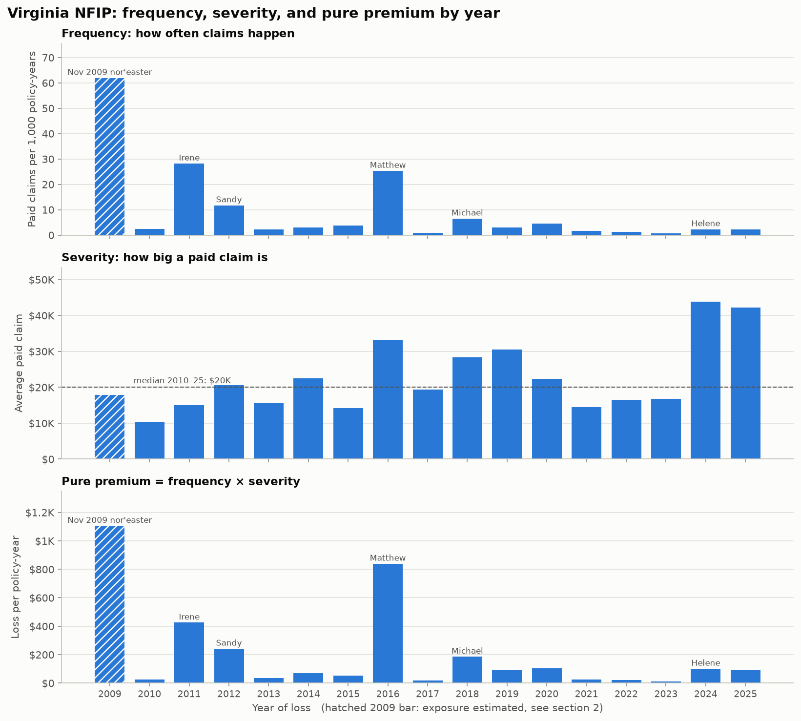

# Flood Risk Explorer
I'm building a flood insurance risk model using FEMA's public data on 2.7 million National Flood Insurance Program claims, starting with Virginia. I calculate the core actuarial measures (claim frequency, severity, and pure premium) and am developing actuarial GLMs and an XGBoost model to compare how well each predicts flood losses by area. So far I've found that Virginia's expected flood loss is about $149 per insured home per year, and that just three storm years caused 69% of all losses since 2010, a pattern that makes flood insurance so hard to price. 

**How often do flood insurance claims happen in an area, how big are they, and what's the expected annual loss per policy?** This project answers those questions with the classic actuarial toolkit, using FEMA's public National Flood Insurance Program (NFIP) data.

- **Data:** OpenFEMA NFIP claims (2.7 million US claims since 1978) and policies (1.67 million Virginia policy terms since 2009).
- **Actuarial foundations:** earned exposure (policy-years), claim **frequency**, claim **severity**, and **pure premium** (expected loss per policy-year), by year and by county.
- **Models (in progress):** Poisson / negative binomial GLMs for frequency, a Gamma GLM for severity, compared against XGBoost, with relativities and SHAP to explain what drives risk. Models are tested on held-out years.
- **App (planned):** a Streamlit app where you pick a county or ZIP code and see its area-level flood risk, expected claim cost, and the reasons behind it.

**Status:** week 1 of 9 done (data, exploration, actuarial basics). See [`docs/PROJECT_PLAN.md`](docs/PROJECT_PLAN.md).

> **Disclaimer:** All results are **area-level** estimates built from aggregated public data. They are not predictions, quotes, or risk ratings for any individual property.

## Key findings so far (Virginia, 2010–2025)
- **Average loss cost: about $149 per policy per year.** That's 6.5 paid claims per 1,000 policy-years × a $23,039 average paid claim.
- **Catastrophe-driven:** the worst 3 years (2009 nor'easter, 2016 Matthew, 2011 Irene) produced **69%** of 2009–2025 losses. The *median* year's loss cost ($79) is about half the average.
- **Storms drive frequency, not severity:** claim frequency swings about 40-fold between years, while the average claim stays roughly between $10K and $44K.
- **Risk per policy ≠ total losses:** Salem, Newport News, and the Roanoke area have the highest pure premiums (about $300–$455, inland river flooding in three of them). Virginia Beach has the most dollars: **30%** of losses from **20%** of exposure.
- **Counts are overdispersed** (about 28× Poisson variance), so the frequency model will need a negative binomial or similar.

Details: [`reports/01_data_overview.md`](reports/01_data_overview.md) · [`reports/02_actuarial_basics.md`](reports/02_actuarial_basics.md)



## Project structure
```
src/download_data.py        download FEMA data (+ Census county names) into data/raw/
src/actuarial.py            earned exposure, frequency, severity, pure premium
notebooks/01_first_look     data exploration
notebooks/02_actuarial_basics   Virginia actuarial measures by year and county
reports/                    written findings + figures
docs/                       data dictionary, project plan
app/                        Streamlit app (coming)
```
Data files live in `data/` and are never committed. Re-create them with the download script.

## How to run (Windows, PowerShell)
```powershell
py -3.13 -m venv .venv
.venv\Scripts\python.exe -m pip install -r requirements.txt
.venv\Scripts\python.exe src\check_setup.py
.venv\Scripts\python.exe src\download_data.py all      # about 35 minutes, ~270 MB
.venv\Scripts\python.exe src\actuarial.py              # self-test + county-year table
.venv\Scripts\jupyter-nbconvert.exe --to notebook --execute --inplace notebooks\02_actuarial_basics.ipynb
```

*This product uses FEMA's OpenFEMA API but is not endorsed by FEMA. FEMA may update the data at any time.*
